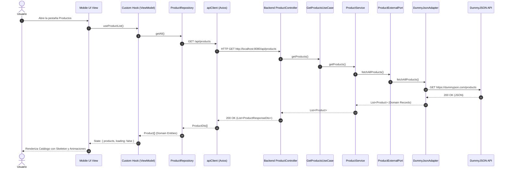
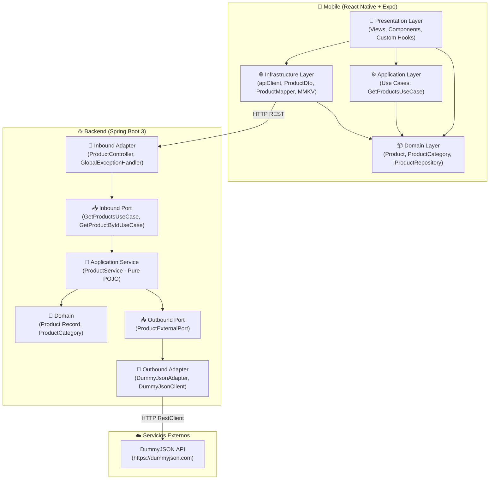

# TOPAZ — Mini-Tienda (Full-Stack Monorepo)

Monorepo de alto estándar técnico compuesto por un **Backend BFF / Proxy (Spring Boot 3.5 + Java 21 LTS)** con **Arquitectura Hexagonal Pura** y una **Aplicación Móvil (React Native + Expo + TypeScript Estricto)** con **Clean Architecture Feature-First**.

---

## 🏗️ 1. Arquitectura y Decisiones Técnicas

### 1.1 Backend: Arquitectura Hexagonal Pura (Ports & Adapters)
- **Domain (`com.topaz.store.domain`)**: Java Records inmutables (`Product`, `ProductCategory`) y los puertos de entrada (`GetProductsUseCase`, `GetProductByIdUseCase`) y salida (`ProductExternalPort`) en `domain.port`. **Cero dependencias** de Spring, Jackson o librerías externas. Los precios se modelan con `BigDecimal` para evitar errores de redondeo.
- **Application (`com.topaz.store.application`)**: `ProductService` implementa los casos de uso; es una clase Java pura sin anotaciones de Spring (`@Service` prohibido). La inyección de dependencias se gestiona en `BeanConfiguration`.
- **Reglas verificadas automáticamente**: `ArchitectureTest` (ArchUnit) hace fallar el build si `domain` o `application` dependen de infraestructura o de frameworks.
- **Infrastructure (`com.topaz.store.infrastructure`)**: 
  - Adaptador de entrada REST (`ProductController`) bajo `/api/products`.
  - Adaptador de salida HTTP (`DummyJsonAdapter` + `RestClient` / `DummyJsonClient`) con mapeo bidireccional estricto.
  - Manejo global de excepciones (`GlobalExceptionHandler`) mapeando errores a RFC 7807 (`ProblemDetail`).
  - Validación de entrada (`@Positive` sobre el `id` → `400 Bad Request` sin llamar a DummyJSON).
  - Caché Caffeine (60 s), cliente HTTP con pool de conexiones (`JdkClientHttpRequestFactory`), *virtual threads*, apagado *graceful* y *health probes* (`/actuator/health/liveness|readiness`).
  - CORS configurable por entorno (`TOPAZ_CORS_ALLOWED_ORIGINS`).

### 1.2 Mobile: Clean Architecture Feature-First
- **Estructura modular por feature**:
  - `features/products/`: Dominio (incluye reglas de precio en `domain/pricing.ts`), casos de uso, búsqueda/filtrado/**ordenamiento** (`filterProducts`), repositorio, mapper, custom hooks (`useProductList`, `useProductDetail`, `useProductFilters`) y componentes UI (`ProductItem`, `ProductCarousel`, `CategoryChips`, `SortChips`, etc.).
  - `features/favorites/`: Estado global con **Zustand + MMKV** (`useFavoritesStore`), `FavoriteButton` con animaciones de **React Native Reanimated** y respuesta háptica con `expo-haptics`.
- **Features desacopladas**: `products` no importa nada de `favorites`; la navegación (`TabNavigator`, `RootNavigator`) compone ambas inyectando el botón de favoritos mediante *render props*. `shared/` no depende de ninguna feature.
- **Errores localizados**: `apiClient` traduce cada código HTTP (404, 502/503, 504, sin red…) a mensajes en español de `STRINGS`; el detalle técnico del servidor se conserva en `ApiError.detail` solo para diagnóstico.
- **Separación de Lógica y Presentación (MVVM)**: Las vistas (`ProductListView`, `ProductDetailView`, `FavoritesListView`) son puramente presentacionales; la lógica reside en custom hooks.
- **Tokens de Diseño Centralizados**: Cero *magic strings* y cero colores *hardcodeados*. Todo se consume de `core/theme/` (`colors.ts`, `spacing.ts`, `typography.ts`, `shadows.ts`, `strings.ts`).
- **Resiliencia de Entornos**: El storage en `mmkvStorage.ts` incluye fallback seguro en memoria para entornos de testing (Jest) o donde el módulo nativo MMKV no esté disponible.

---

## 📊 2. Diagramas de Arquitectura (Mermaid)

### 2.1 Flujo de Datos End-to-End



### 2.2 Diagrama de Capas del Monorepo



---

## 🛠️ 3. Requisitos Previos

- **macOS** (probado en macOS Sequoia 15.6+ / Apple Silicon & Intel).
- **Java**: 21+ (`java -version`). Maven **no** es necesario: el proyecto incluye Maven Wrapper (`./mvnw`).
- **Node.js**: 20+ o 22 (`node -v`).
- **Xcode**: 16.0+ con Command Line Tools instaladas (`xcode-select --install`) y un simulador de iOS activo (ej. iPhone 16 Plus con iOS 18+).
- **CocoaPods**: (`brew install cocoapods` o `gem install cocoapods`).

---

## 🚀 4. Guía de Ejecución Paso a Paso

### 4.1 Backend (Spring Boot)

En una terminal dedicada:

```bash
cd backend
./mvnw clean spring-boot:run
```

**Documentación interactiva (Swagger UI):** http://localhost:8080/swagger-ui.html

**Con Docker:**
```bash
cd backend
docker build -t topaz-backend .
docker run -p 8080:8080 -e TOPAZ_CORS_ALLOWED_ORIGINS="http://localhost:8081" topaz-backend
```

**Verificación de salud del backend:**
```bash
# Listado de productos
curl -i http://localhost:8080/api/products

# Detalle de producto específico
curl -i http://localhost:8080/api/products/1
```

---

### 4.2 Mobile (iOS Simulator)

En una segunda terminal:

```bash
cd mobile
npm install

# Iniciar servidor Metro en localhost y abrir en iOS Simulator
npx expo start --localhost --ios
```

> **Dispositivo físico:** copia `mobile/.env.example` a `mobile/.env.local` y define `EXPO_PUBLIC_API_URL` con la IP de tu Mac en la red local (p. ej. `http://192.168.1.50:8080/api`). Sin esa variable se usan los valores por defecto del simulador/emulador.

> **Nota:** La aplicación se abre automáticamente en el simulador configurado (`iPhone 16 Plus`). Puedes pulsar `r` en la terminal de Metro en cualquier momento para recargar la aplicación en caliente (*Fast Refresh*).

---

### 4.3 Mobile (Android Emulator)

1. Abre **Android Studio** e inicia un emulador desde el *Device Manager* (recomendado imagen `arm64-v8a` para procesadores Apple Silicon).
2. Asegúrate de tener `ANDROID_HOME` configurado en tu terminal:
   ```bash
   export ANDROID_HOME=$HOME/Library/Android/sdk
   export PATH=$PATH:$ANDROID_HOME/emulator:$PATH:$ANDROID_HOME/platform-tools
   ```
3. Ejecuta:
   ```bash
   cd mobile
   npx expo run:android
   ```
> **Nota de Red:** La configuración de red en `mobile/src/core/config/env.ts` mapea automáticamente la URL del backend a `http://10.0.2.2:8080/api` en Android, que es la dirección puente del emulador hacia el `localhost` de tu Mac.

---

## 🧪 5. Ejecución de Tests

Ambas suites de pruebas siguen estrictamente la estructura **AAA** (*Arrange, Act, Assert*) y están verificadas al 100%.

### Tests del Backend (26 pruebas unitarias, de integración y de arquitectura)
```bash
cd backend
./mvnw verify
```
- Cobertura: Casos de uso de productos, controlador REST con `MockMvc` (incluida validación del `id`), cliente externo `RestClient` con `MockRestServiceServer`, adaptador con mapeo de errores y reglas hexagonales con ArchUnit.

### Calidad y Tests de Mobile (73 pruebas unitarias y de componentes)
```bash
cd mobile
npm run typecheck     # TypeScript estricto
npm run lint          # ESLint (eslint-config-expo + Prettier)
npm run format:check  # Prettier
npm test              # Jest
npm run validate      # todo lo anterior + cobertura
```
- Cobertura: Store de Zustand + persistencia, custom hooks con `renderHook` (`useProductList`, `useProductDetail`, `useProductFilters`), vistas (`ProductListView` con ordenamiento, `ProductDetailView`, `FavoritesListView`), componentes UI, `apiClient` (errores localizados), repositorio, mapper, reglas de precio y formateo.

### Integración Continua
`.github/workflows/ci.yml` ejecuta en cada *push* y *pull request* el build del backend (`./mvnw verify`) y la validación completa del mobile (typecheck, lint, formato y tests).

---

## 🔧 6. Solución de Problemas (Troubleshooting)

### 1. Codificación UTF-8 en CocoaPods / Ruby 3.4
Si al ejecutar comandos de CocoaPods obtienes un error como `UnicodeNormalize not appropriate for ASCII-8BIT`:
```bash
export LANG=en_US.UTF-8
export LC_ALL=en_US.UTF-8
pod install --project-directory=mobile/ios
```

### 2. Error de red `Network request failed` en iOS Simulator
El simulador de iOS comparte la pila de red con tu Mac. Asegúrate de que el backend esté arriba en el puerto 8080 (`curl http://localhost:8080/api/products`).

### 3. Conexión en Emulador de Android
Los emuladores de Android no pueden acceder al host mediante `localhost`. El archivo `mobile/src/core/config/env.ts` ya contempla `http://10.0.2.2:8080/api` mediante `Platform.select`. Si usas un dispositivo físico por USB, ejecuta:
```bash
adb reverse tcp:8080 tcp:8080
```
