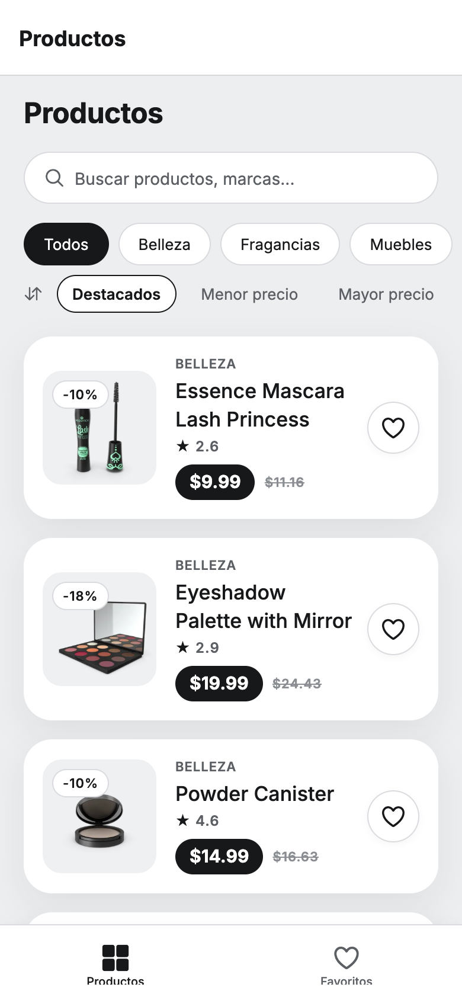
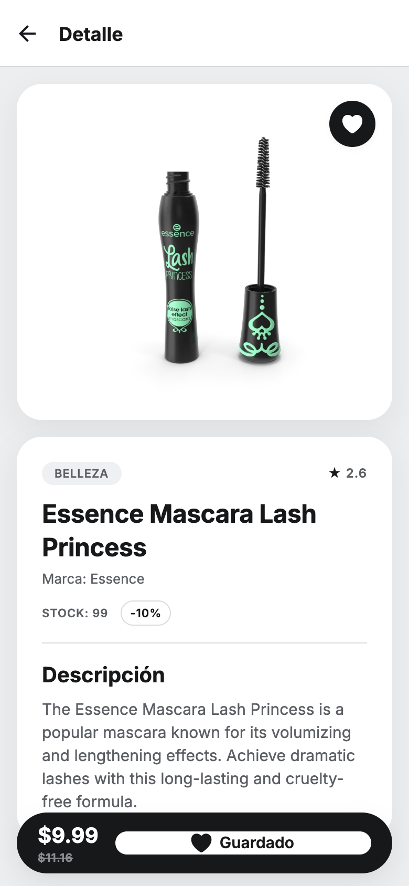
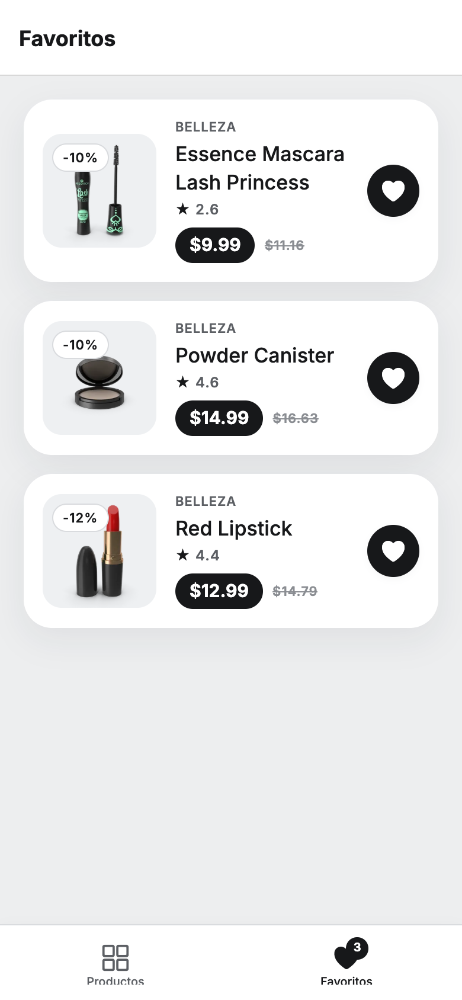
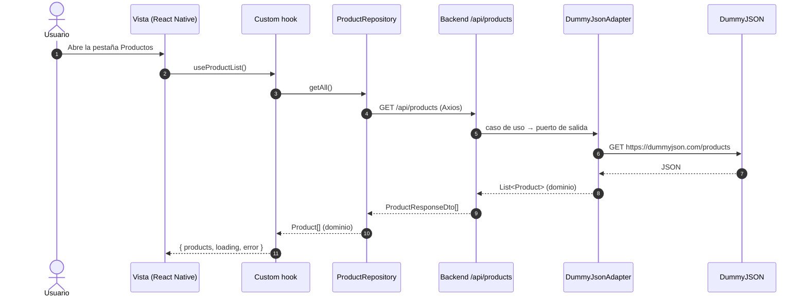

# TOPAZ — Mini-Tienda de Productos

[](https://github.com/luisamarquez200/topaz-mini-store/actions/workflows/ci.yml)

Aplicación móvil en **React Native (Expo SDK 58 + TypeScript)** que consume un **microservicio Spring Boot 3.5 (Java 21) con arquitectura hexagonal**, el cual a su vez consume la API pública de [DummyJSON](https://dummyjson.com). Los favoritos se guardan localmente con **Zustand + MMKV**.

| Productos | Detalle | Favoritos |
|:---:|:---:|:---:|
|  |  |  |

---

## Contenido

1. [Inicio rápido](#1-inicio-rápido)
2. [Requisitos de la prueba](#2-requisitos-de-la-prueba)
3. [Arquitectura](#3-arquitectura)
4. [Requisitos previos](#4-requisitos-previos)
5. [Cómo ejecutar](#5-cómo-ejecutar)
6. [Tests y calidad](#6-tests-y-calidad)
7. [Solución de problemas](#7-solución-de-problemas)

---

## 1. Inicio rápido

```bash
# Terminal 1 — backend (http://localhost:8080)
cd backend
./mvnw spring-boot:run

# Terminal 2 — app (se abre en el navegador)
cd mobile
npm install
npm run web
```

Para iOS o Android, ver [sección 5](#5-cómo-ejecutar).

---

## 2. Requisitos de la prueba

| Requisito | Implementación |
|---|---|
| Pantalla **Productos** con `FlatList`, imagen, título y precio | `ProductListView` + `ProductItem` (`React.memo`) |
| Estados de carga y error | Skeleton / `ActivityIndicator` y `ErrorView` con botón de reintento |
| Pantalla **Detalle** por ID | `ProductDetailView` + hook `useProductDetail` |
| Carrusel de imágenes | `ProductCarousel`: `FlatList` horizontal con `pagingEnabled` e indicadores |
| Título, descripción, precio y rating | `ProductDetailView` |
| Botón **Añadir a Favoritos** con feedback visual | `FavoriteButton` (animado con Reanimated) |
| Pantalla **Favoritos** desde almacenamiento local, en tiempo real | `FavoritesListView` suscrita al store de Zustand |
| TypeScript | Modo estricto; `npm run typecheck` sin errores |
| Componentes funcionales, hooks y custom hooks | `useProductList`, `useProductDetail`, `useProductFilters`, `useFavorites`, `useDebouncedValue` |
| React Navigation 6+ (Stack + Bottom Tabs) | React Navigation 7: `RootNavigator` (native stack) + `TabNavigator` |
| Estado global | Zustand (`useFavoritesStore`) |
| Persistencia | MMKV mediante el middleware `persist` de Zustand |
| Estilos | `StyleSheet` nativo con tokens de diseño en `core/theme/` |
| Networking | Axios (`core/api/apiClient.ts`) |
| Optimización de `FlatList` | `keyExtractor`, `ItemSeparatorComponent`, `renderItem` memoizado, ítems con `React.memo` |
| Microservicio Spring Boot hexagonal | `backend/`, con reglas de capas verificadas por ArchUnit |
| **Bonus:** Jest + React Native Testing Library | 73 tests en mobile |
| **Bonus:** Reanimated | Animación del corazón al marcar favorito |

**Extras:** búsqueda con *debounce*, filtro por categoría, ordenamiento por precio y rating, mensajes de error en español, respuesta háptica, caché en el backend, Swagger, Dockerfile y CI en GitHub Actions.

---

## 3. Arquitectura

### 3.1 Backend: arquitectura hexagonal (Ports & Adapters)

```
backend/src/main/java/com/topaz/store/
├── domain/            # Records inmutables y puertos (in/out). Sin dependencias de Spring.
├── application/       # ProductService: implementa los casos de uso. Java puro, sin anotaciones.
└── infrastructure/
    ├── adapter/in/    # ProductController (REST) y DTOs de respuesta
    ├── adapter/out/   # DummyJsonAdapter + DummyJsonClient (RestClient) y mapper
    ├── config/        # Wiring de beans, CORS, caché, propiedades
    └── exception/     # GlobalExceptionHandler → respuestas RFC 7807 (ProblemDetail)
```

- **Endpoints:** `GET /api/products` y `GET /api/products/{id}`. Documentación en Swagger UI: http://localhost:8080/swagger-ui.html
- **Reglas de capas verificadas:** `ArchitectureTest` (ArchUnit) hace fallar el build si `domain` o `application` dependen de infraestructura o de Spring.
- **Robustez:** validación del `id` (`@Positive` → `400` sin llamar a DummyJSON), errores del proveedor mapeados a `404`/`502`/`504`, caché Caffeine de 60 s, timeouts configurables y *health probes* en `/actuator/health`.
- **Precios** modelados con `BigDecimal`.

### 3.2 Mobile: Clean Architecture por feature

```
mobile/src/
├── core/              # apiClient (Axios), configuración, storage MMKV, tema y textos
├── di/                # Composición de repositorios y casos de uso
├── features/
│   ├── products/      # domain → application → infrastructure → presentation
│   └── favorites/     # Store de Zustand persistido + FavoriteButton + vista
├── navigation/        # RootNavigator (stack) y TabNavigator (tabs)
└── shared/            # Componentes y hooks reutilizables
```

- **Vistas presentacionales, lógica en hooks:** las vistas solo renderizan; la carga de datos y el estado viven en custom hooks.
- **Features desacopladas:** `products` no importa nada de `favorites`. La navegación inyecta el botón de favoritos en las vistas de productos mediante *render props*.
- **Errores localizados:** `apiClient` traduce cada código HTTP y los fallos de red a mensajes en español.
- **Tokens de diseño:** colores, espaciados, tipografía y textos centralizados en `core/theme/`.

### 3.3 Flujo de datos



---

## 4. Requisitos previos

| Herramienta | Versión | Para qué |
|---|---|---|
| Java (JDK) | 21+ | Backend. Maven **no** es necesario: se incluye Maven Wrapper (`./mvnw`). |
| Node.js | 20 o 22 | App móvil |
| Navegador moderno | — | Versión web (la forma más rápida de probar) |
| Xcode | 26+ | Solo iOS (Expo SDK 58 no compila con versiones anteriores), con CocoaPods |
| Android Studio | Reciente, con un emulador | Solo Android |

---

## 5. Cómo ejecutar

### 5.1 Backend

```bash
cd backend
./mvnw spring-boot:run
```

Comprobación:

```bash
curl http://localhost:8080/api/products
curl http://localhost:8080/api/products/1
```

Con Docker:

```bash
cd backend
docker build -t topaz-backend .
docker run -p 8080:8080 topaz-backend
```

### 5.2 App en el navegador

```bash
cd mobile
npm install
npm run web
```

Se abre en http://localhost:8081. Para verla con tamaño de teléfono, activa el modo dispositivo en las herramientas de desarrollador del navegador.

### 5.3 App en iOS (simulador)

La app usa MMKV, que requiere código nativo, así que se compila una *development build* (no funciona en Expo Go):

```bash
cd mobile
npm install
npx expo run:ios
```

### 5.4 App en Android (emulador)

1. Inicia un emulador desde el *Device Manager* de Android Studio.
2. Ejecuta:
   ```bash
   cd mobile
   npm install
   npx expo run:android
   ```

En Android, la app usa automáticamente `http://10.0.2.2:8080/api`, que es la dirección del emulador hacia el `localhost` del computador.

### 5.5 Dispositivo físico

Copia `mobile/.env.example` a `mobile/.env.local` y define `EXPO_PUBLIC_API_URL` con la IP del computador en la red local (por ejemplo `http://192.168.1.50:8080/api`). Con un Android conectado por USB también puedes usar `adb reverse tcp:8080 tcp:8080`.

---

## 6. Tests y calidad

### Backend: 26 tests

```bash
cd backend
./mvnw verify
```

Casos de uso, controlador REST con `MockMvc` (incluida la validación del `id`), cliente HTTP con `MockRestServiceServer`, adaptador y mapper, y reglas de arquitectura con ArchUnit.

### Mobile: 73 tests

```bash
cd mobile
npm run typecheck     # TypeScript
npm run lint          # ESLint
npm run format:check  # Prettier
npm test              # Jest + React Native Testing Library
npm run validate      # typecheck + lint + tests con cobertura
```

Store de favoritos y su persistencia, custom hooks (`renderHook`), vistas, componentes, `apiClient`, repositorio, mapper y utilidades de precio y formato.

### Integración continua

`.github/workflows/ci.yml` ejecuta en cada *push* y *pull request* los tests del backend y la validación completa del mobile.

---

## 7. Solución de problemas

**`Network Error` en la app.** Verifica que el backend esté corriendo: `curl http://localhost:8080/api/products`.

**Android no conecta con el backend.** El emulador no ve `localhost`; la app ya usa `10.0.2.2`. En un dispositivo físico, usa `EXPO_PUBLIC_API_URL` o `adb reverse` (sección 5.5).

**Error de codificación de CocoaPods (`UnicodeNormalize not appropriate for ASCII-8BIT`).**

```bash
export LANG=en_US.UTF-8
export LC_ALL=en_US.UTF-8
```
